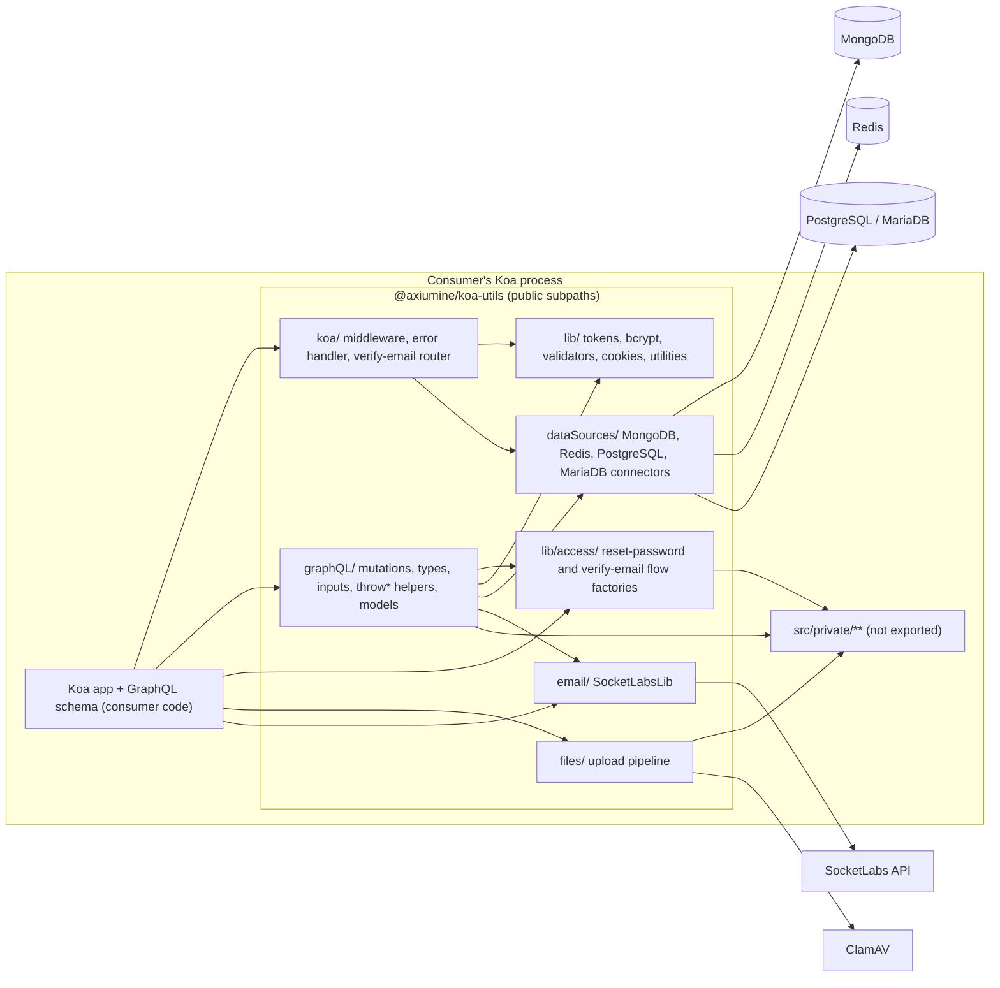

# Architecture

A high-level design of `@axiumine/koa-utils`. For the file-by-file map see [REPO.md](../REPO.md); for every function's signature see [docs/code/](code/README.md); for the security view of the same structure see [security.md](security.md).

## What it is

A library, not a service. It has no process, port or scheduler of its own. A consumer's Koa application imports the pieces it needs and runs them inside its own process, with its own configuration and credentials. The package ships ESM only (`.mjs` and `.d.mts`), has zero runtime `dependencies`, and declares 19 `peerDependencies` (seven required, twelve optional).

## Structure

There is no barrel. Each public symbol lives in its own file and is reachable only through its own `exports` subpath (150 of them). That is a design decision with a consequence: a consumer that never imports a subpath never loads the optional peer behind it.

| Area | Responsibility | Talks to |
|---|---|---|
| `koa/` | Middleware that authenticates a request (`authenticatedResourceHandler`, `authenticatedAuthorizationHandler`, `authenticatedLogoutHandler`), the top-level error handler, the verify-email router | Redis, Keygrip |
| `graphQL/` | Mutation definitions (`signUp`, `login*`, `refresh`, `logout`, `resetPwd`, `updatePassword`, `emailChangeHashVerify`), object and input types, `throw*` error helpers, Mongoose models | MongoDB, Redis, SocketLabs |
| `lib/access/` | Model-agnostic factories (`createResetPwdFlow`, `createVerifyEmailFlow`) that bind the reset and verification flows to any Mongoose model and field layout | MongoDB |
| `lib/` | Token generation, bcrypt helpers, cookie options, input validators, redirect allowlist, small utility classes, and `lib/db/` (user registration and lookup, request and error logs) | MongoDB (through `lib/db/` only) |
| `dataSources/` | Connect and disconnect helpers for the four stores, and the module-level connection objects (`redisClient`, `sequelize`, `pgPool`). `REDIS_TLS` is read here (through `private/dataSources/`) | MongoDB, Redis, PostgreSQL, MariaDB |
| `files/` | Upload pipeline: stream to a temp file, extension and MIME check, ClamAV scan, image re-encode, move | local disk, ClamAV |
| `email/` | Transactional email through SocketLabs | SocketLabs HTTPS API |
| `private/` | Internals the public modules call into. Never exported, never to be imported by a consumer | whatever the caller needs |

## Key flows

**Sign-up and verification.** `signUp` writes a user with `account.email.valid = false` and an `account.email.hash`, then mails a link. The verify-email router checks email and hash through a chain of `handleIf*` guards, enables the account and redirects to a path on an allowlist.

**Login.** `login*` compares the password with bcrypt, creates a random access token and a random refresh token, stores both in Redis with a TTL, sets a signed `refresh_token` cookie and returns the access token in the response body.

**Authenticated request.** `authenticatedResourceHandler` reads `Authorization: Bearer access:<uuid>`, checks the UUID shape, looks the key up in Redis, rejects a blocked or deleted account and fills `ctx.state.user`. Nothing is cached between requests.

**Refresh and logout.** `authenticatedAuthorizationHandler` verifies the signed refresh cookie with the consumer's Keygrip instance and reads the refresh entry; `refresh` rotates both tokens and deletes the old entry. `logout` deletes the Redis keys and clears the cookie.

**Password reset.** `resetPwd` stores a random `account.resetHash` and mails a link; `updatePassword` accepts it only within its window and only if the hash matches. It never reads or writes the email-verification hash.

**Upload.** The stream is capped at 5 MB, written to a temp file, checked by extension and by magic number, scanned by ClamAV and, for images, re-encoded with sharp. A file that fails a step is rejected.

## Configuration and state

The library keeps no persistent state of its own. In memory it holds module-level connection objects, the ClamAV scanner created by `initClamScan()` and, per verify-email flow, a small map used to debounce notification mails. Configuration is environment variables (see the table in [README.md](../README.md#environment-variables)), read from `process.env`, which each module fills with `dotenv`, plus the arguments the consumer passes in (the Keygrip instance, the `paths` of the access factories, custom mailers). Persistent state is in the consumer's MongoDB (users, logs) and Redis (sessions).

## Build and release

TypeScript sources (`.mts`) are compiled by `tspc` (ts-patch) with `typescript-transform-paths`, which turns the `@lib/*` style aliases into relative imports, and the output is renamed to `.mjs`. The build is deterministic: CI checks that two clean builds are byte-identical, and the 7.1.0 tarball rebuilt from its tag has the same SHA-1 as the one on npm ([verify-release.md](verify-release.md)). The tarball contains `dist/` without source maps.

Quality gates run before code reaches `main` and again in CI: Mocha tests with a 100% per-file c8 coverage gate, ESLint and Prettier, Semgrep (custom rules plus a canary suite that proves the rules still detect) and a Qodana scan.
