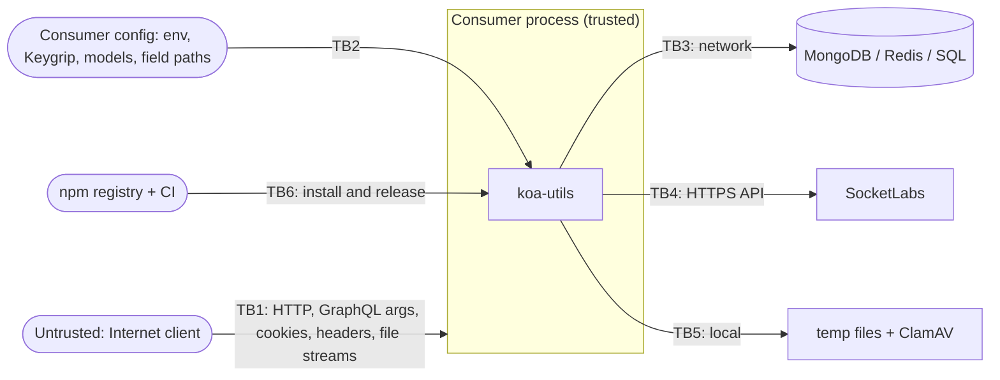

# Security requirements and assurance case

This page states what security you can and cannot expect from `@axiumine/koa-utils`, the threats it was designed against, where the trust boundaries lie, and why the maintainer believes the requirements are met. It describes version 7.x. To report a vulnerability, see [SECURITY.md](../SECURITY.md). For the structure that this page refers to, see [architecture.md](architecture.md). Last reviewed 2026-10-30.

Evidence is named as a file in `src/`, a spec in `test/`, a Semgrep rule in `.semgrep/koa-utils.yml` or an entry in [CHANGELOG.md](../CHANGELOG.md), so each claim can be checked.

## 1. Scope

The library runs inside the consumer's Koa process. It authenticates users, guards requests, validates uploads, talks to the consumer's databases and sends email. It does not terminate TLS, does not decide what an authenticated user may do, and does not run anything of its own. The consumer's application, reverse proxy and infrastructure are outside its control and are listed as limits in section 3.

## 2. Security requirements: what you can expect

| # | Requirement | How it is met | Evidence |
|---|---|---|---|
| R1 | Passwords are never stored in plain text, and their length is bounded. | bcrypt with cost 14 through `encryptPassword` and `compareHashAsync`. Passwords must be 10 to 72 characters, checked before hashing (the limit is counted in characters, see L12). | `src/lib/encryptPassword.mts`, `src/lib/checkPwdLen.mts`, `test/lib/encryptPassword.spec.mts`, `test/lib/checkPwdLen.spec.mts` |
| R2 | Session tokens cannot be guessed. | Access and refresh tokens are random UUID v4 values. The UUID shape is checked before a token reaches Redis. Access lifetime is 30 to 90 minutes, refresh lifetime 90 days; refresh rotates both tokens and deletes the old entry; logout deletes the keys. | `src/lib/tokens.mts`, `src/lib/isValidUuidV4.mts`, `src/koa/middleware/**`, `test/koa/middleware/` |
| R3 | A request is authenticated on every call. | `authenticatedResourceHandler` looks the access token up in Redis on each request and rejects a session whose `disabled` or `deleted` field in the Redis session hash holds any non-empty value (Redis stores strings, so even `'false'` blocks), so a consumer can block a user at once by setting the field there. The library itself caches nothing. | `src/koa/middleware/authenticatedResourceHandler/index.mts`, `src/lib/isSessionBlocked.mts` |
| R4 | The refresh cookie cannot be forged or read by scripts. | Cookies are `httpOnly` and `SameSite=Strict`. Koa signs the refresh cookie with the keys the consumer sets on `app.keys`; `authenticatedAuthorizationHandler` verifies the signature with the consumer's Keygrip instance, and a missing or invalid signature is rejected. | `src/lib/tokenOptions.mts`, `src/koa/middleware/authenticatedAuthorizationHandler/verifySignedRefreshToken.mts` |
| R5 | A mail link proves only what it was issued for. | `account.email.hash` proves ownership of an inbox (3-day life); `account.resetHash` authorises a password reset (60-minute life, 10-minute throttle). The two fields are never interchangeable, and a reset with no hash on file fails closed. Both hashes are 50 random characters from `crypto.randomBytes` and are compared in constant time (`safeEqualSecret`). | `src/lib/emailHash.mts`, `src/lib/StringLib.mts`, `src/lib/access/`, CHANGELOG 4.0.0, 5.0.2 and 5.1.0 |
| R6 | The reset and verification flows do not reveal which addresses are registered, and cannot be used to mail-bomb one. | An unknown, deleted or disabled address is answered like a valid one; for the reset mutation the one residual difference is a timing gap of about a millisecond, explained in [graphql-mutations.md](code/graphql-mutations.md). The reset mutation allows one mail per address per 10 minutes. The verify-email guards debounce their notification mails per address and template, 15 minutes by default, in the memory of each process (a consumer can pass its own `mailThrottle`, for example a Redis-backed one). | CHANGELOG 5.2.0, 5.4.0 and 5.7.0, `src/lib/access/createMailThrottle.mts`, `test/lib/access/` |
| R7 | The schema-introspection bypass cannot be switched on in production. | `x-introspectioncode` is honoured only when `NODE_ENV` is exactly `development` or `test`. The allowlist is checked before the secret is read, and the secret is compared in constant time. | `src/lib/isIntrospectionBypassAllowed.mts`, `src/private/lib/verifyIntrospectionCode.mts`, `test/private/lib/verifyIntrospectionCode.spec.mts` |
| R8 | Untrusted input is checked against an allowlist, and invalid input is rejected. | Email and password length (`checkEmailLen`, `checkPwdLen`); UUID shape; GraphQL argument types; redirect targets must match `^/x/[a-zA-Z0-9._\-%/]+$` (`isSafeRedirectTarget`); uploads need an allowed extension and a matching magic number; file paths are checked against traversal (`assertNoTraversal`); `MongoDBConnect` turns on Mongoose `sanitizeFilter`. | `src/lib/isSafeRedirectTarget.mts`, `src/files/validate*.mts`, `src/private/files/assertNoTraversal.mts`, `src/dataSources/MongoDB.mts`, matching specs in `test/` |
| R9 | An uploaded file is size-capped, type-checked and scanned before the consumer uses it. | 5 MB stream cap by default; extension and magic-number check; ClamAV scan; images are re-encoded with sharp, so the stored file is rebuilt from the decoded pixels and the original EXIF data is discarded (L13 covers other metadata). PDFs are scanned but not re-encoded. | `src/files/`, `docs/code/files.md`, `test/files/` |
| R10 | The library never weakens TLS, and can require it for Redis. | No module in `src/` disables certificate verification (`rejectUnauthorized: false` and `NODE_TLS_REJECT_UNAUTHORIZED` do not appear), and none sets a TLS version, so Node's defaults apply (minimum TLS 1.2). With `REDIS_TLS=true` the Redis URL must use `rediss://`, and loading the module throws otherwise. For MongoDB, PostgreSQL and MariaDB the library sets no TLS option (L7). | `src/dataSources/Redis.mts`, `src/private/dataSources/`, CHANGELOG 7.1.0 |
| R11 | Secrets are not in the code. | Credentials come from environment variables or the consumer's own objects. The `HardcodedPasswords` inspection of the Qodana profile (see the comments in `qodana.yaml`) and Semgrep run on every push to `main`. | `.env.example`, `qodana.yaml`, `.github/workflows/qodana.yml`, `.github/workflows/semgrep.yml` |
| R12 | The package adds no third-party code to your tree. | Zero runtime `dependencies`. Every library is a peer dependency chosen and updated by you; the twelve optional ones load only if you import the subpath that needs them. | `package.json`, README "Install" |
| R13 | A release is what the maintainer built. | Release tags from `v5.0.0` on are SSH-signed. The 7.1.0 tarball was rebuilt from its tag and has the same SHA-1 as the one on npm, and CI checks on every change that two clean builds are byte-identical. | [verify-release.md](verify-release.md), `.github/workflows/ci.yml` |

## 3. What you cannot expect

| # | Limit | What to do |
|---|---|---|
| L1 | **Transport security.** Cookies are issued with `secure: false` by design (`src/lib/tokenOptions.mts`); TLS is expected to end at your reverse proxy. Over plain HTTP the tokens are readable on the wire. | Terminate TLS in front of the app and set `Secure` on the cookies there. |
| L2 | **Authorisation.** The library proves who the caller is and whether the account is blocked. It does not decide what the caller may read or change. | Check permissions in your resolvers. |
| L3 | **Brute-force and rate limiting.** There is no limiter or lockout on the login mutations. Only the reset and verification flows are throttled. | Rate-limit at the proxy or in your app. |
| L4 | **Account enumeration at login and sign-up.** A login for an unknown email answers 401 while a wrong password answers 403, and `signUp` has a timing difference for an existing address ([REPO.md](../REPO.md), "Known quirks"). The reset and verification flows (R6) are not affected. | Treat login and sign-up as enumerable. |
| L5 | **Cross-site request forgery.** `SameSite=Strict` on the cookies is the only mitigation the library provides. | Add CSRF protection to your GraphQL endpoint. |
| L6 | **Cookie signing algorithm.** The refresh cookie is signed with `app.keys` and verified with the Keygrip instance you pass in. Keygrip defaults to HMAC-SHA1. | Create it with `new Keygrip(keys, 'sha256')` and use the same instance for `app.keys` and for the handlers. |
| L7 | **Plain-text data-store links by default.** `REDIS_TLS` is opt-in so that existing deployments are unchanged. The PostgreSQL and MariaDB connectors set no TLS option, and MongoDB uses whatever your `MONGODB_URI` asks for. | Set `REDIS_TLS=true` and use a `rediss://` URL; enable TLS for the other stores in their own configuration. |
| L8 | **Data at rest.** Nothing is encrypted by the library, and database and Redis hardening is yours. | Use the encryption and access control your databases offer. |
| L9 | **Malware detection.** ClamAV finds known signatures only, and only as fresh as the signature database you maintain. | Update ClamAV; do not serve uploads from an executable path. |
| L10 | **Your peers.** You choose their versions. For example, `@socketlabs/email` 1.4.4, its latest release, depends on `axios` `^0.21.1`, a range with published advisories that this package cannot fix. | Run an audit on your own tree. |
| L11 | **HTML in email.** `SocketLabsLib` puts the `name` you pass to the send methods, and the `err` text you pass to `alertDevTeam`, into the HTML body without escaping them (`fixName` only adds a leading space). | Pass only values you have escaped or trust. |
| L12 | **Password length is counted in characters.** `checkPwdLen` accepts 10 to 72 characters, but bcrypt reads at most 72 bytes. A password made of multi-byte characters can pass the check and still be cut at 72 bytes (verified with `@node-rs/bcrypt`: two passwords that share their first 72 bytes verify against each other). | Treat the first 72 bytes as the effective password, or limit the byte length in your own validation. |
| L13 | **Image metadata other than EXIF.** The re-encode step passes sharp `withMetadata({})` and `withExif({})`. The original EXIF data is gone, but an XMP block in the input survived into JPEG and WebP output in a test with sharp 0.35.5. | Do not rely on the upload pipeline to anonymise images; strip metadata yourself if privacy matters. |

## 4. Threat model

**Assets.** Account credentials (bcrypt hashes in MongoDB); session tokens (Redis); the signed refresh cookie; email-verification and password-reset hashes; the integrity of the user collection; the file store; outbound email reputation; the consumer's secrets (database URIs, SocketLabs key, cookie keys).

**Adversaries.**

| Adversary | Capability | Main goals |
|---|---|---|
| Unauthenticated remote user | Sends arbitrary HTTP, GraphQL arguments, cookies, headers and file streams | Take over an account, bypass login, enumerate users, inject into a query, mail-bomb a victim, upload malware |
| Authenticated low-privilege user | Valid access token for their own account | Reach another account's data, use a stale or disabled session |
| Network attacker between the app and its stores | Reads or alters traffic to MongoDB, Redis, SQL and SocketLabs | Steal tokens or hashes, tamper with sessions |
| Compromised dependency or build | Malicious code in a transitive package, CI or the registry | Run code in every consumer's process |
| Careless consumer | Misconfigures env, proxy or schema | Weaken the library by accident |

**Out of scope.** An attacker with code execution in the consumer's process, with the consumer's database credentials, or with control of the consumer's DNS or TLS certificates; denial of service by volume; physical access; the security of the consumer's own resolvers.

## 5. Trust boundaries

| Boundary | Data crossing | Controls where it enters the library |
|---|---|---|
| TB1 Internet to library | Authorization header, cookies, GraphQL arguments, uploaded streams, the verify-email URL | Token shape and Redis lookup (R2, R3), cookie signature (R4), argument types and length checks (R8), upload pipeline (R9), redirect allowlist (R8), hash comparison with expiry and throttle (R5, R6) |
| TB2 Consumer configuration to library | Environment variables, the Keygrip instance, model and `paths` for the access factories | Fails closed on missing or inconsistent configuration: no reset hash, `REDIS_TLS` with a plain URL, `NODE_ENV` outside the allowlist (R5, R7, R10). Field paths come from code, not from requests, and must stay that way |
| TB3 Library to data stores | Queries, session hashes | `sanitizeFilter` through `MongoDBConnect`, parameterised SQL, UUID-validated Redis keys (R8); TLS opt-in for Redis, none set for the other stores (R10, L7) |
| TB4 Library to SocketLabs | Recipient, subject, body and the API key | HTTPS through the `@socketlabs/email` client; the key comes from the environment (R11) |
| TB5 Library to local disk and ClamAV | Temp files from untrusted uploads | Generated file names, traversal check, size cap, scan before use (R9) |
| TB6 Registry and CI to consumer | The published tarball | Signed tags, reproducible build, zero runtime dependencies (R12, R13); releases published through the release workflow add a build attestation |

## 6. Secure design principles

| Principle | How it is applied here |
|---|---|
| Economy of mechanism | One named export per file; no barrel; a size and complexity budget in ESLint (`max-lines-per-function` 50, `complexity` 10, reported as warnings); no runtime dependencies. |
| Fail-safe defaults | The introspection bypass is an allowlist (`development`, `test`), not "anything but production". A missing reset hash rejects the reset. `REDIS_TLS` refuses a plain URL instead of rewriting it. Optional peers stay unloaded until imported. |
| Complete mediation | Every request is checked against Redis; the blocked flag in the session is read on each call; the verify-email router sends every redirect through `isSafeRedirectTarget`; Semgrep recognises only that function as a redirect sanitiser, so an ad-hoc check is reported. |
| Open design | The source, the rules and this page are public. Nothing relies on `src/private/` being secret; it is unexported to keep the API small. |
| Separation of privilege | Access and refresh tokens are distinct and are checked by different middleware. The email-verification hash and the reset hash are different fields. Admin login uses its own model. |
| Least privilege | The library holds no standing credentials; it uses what the consumer injects. Access tokens live 30 to 90 minutes. |
| Least common mechanism | The reset and verification flows use separate hash fields, and each verify-email flow builds its own mail throttle. The flow factories take the field layout as a parameter instead of a shared schema. |
| Psychological acceptability | Safe behaviour needs no options: every flow works with defaults, errors are named `throw*` helpers with stable status codes, and the README shows the minimal setup. The exceptions are the settings listed as limits (cookie `Secure`, `REDIS_TLS`, the Keygrip algorithm). |
| Limit the attack surface | Optional peers; `src/private/**` is never exported; a documented, finite list of 150 subpaths. |

## 7. Common weaknesses and how they are countered

| Weakness (OWASP Top 10 2021 / CWE) | Countermeasure | Evidence |
|---|---|---|
| A01 Broken access control, CWE-284, CWE-862 | Per-request session check, blocked-account flag, introspection allowlist. The consumer owns resource-level authorisation (L2). | R3, R7 |
| A02 Cryptographic failures, CWE-327, CWE-330, CWE-916 | bcrypt cost 14; hashes and tokens from a CSPRNG; `Math.random` is not used for secrets (it only jitters the token lifetime in `accessTokenExpiry`, and `StringLib` was moved off it); constant-time compare for the introspection code and the mail hashes. | R1, R2, R5, R7; CHANGELOG 5.x |
| A03 Injection, CWE-943 (NoSQL), CWE-89 (SQL), CWE-22 (path traversal) | `sanitizeFilter` (set by `MongoDBConnect`); parameterised queries; UUID-checked Redis keys; traversal check on file names. Semgrep rules `nosql-injection.*`, `sql-injection.*`, `redis-injection.*` and `path-traversal.*` run in CI together with a canary suite that proves they still detect. | R8; `.semgrep/koa-utils.yml`; `scripts/semgrep-canaries/` |
| A04 Insecure design, CWE-639 | Reset and verification hashes separated after a real defect (CHANGELOG 5.0.2 to 5.3.0). | R5 |
| A05 Security misconfiguration, CWE-16 | Fail-closed gates on `NODE_ENV` and `REDIS_TLS`. The remaining misconfiguration risks are listed as L1 and L7. | R7, R10 |
| A06 Vulnerable components, CWE-1104 | Zero runtime dependencies; dev tree under Dependabot, a weekly audit, Qodana and Semgrep. | R12, [SECURITY.md](../SECURITY.md#dependencies) |
| A07 Identification and authentication failures, CWE-287, CWE-307, CWE-640 | Session design (R2, R3), signed refresh cookie, throttled reset. No login lockout (L3). | R1 to R6 |
| A08 Software and data integrity failures, CWE-494 | Signed tags, reproducible tarball, a locked dependency tree with a pre-commit check that the lockfile names only `registry.npmjs.org`, and GitHub Actions pinned by commit SHA. | R13, `.githooks/pre-commit`, `.github/workflows/` |
| A09 Logging and monitoring failures | Failures are captured with Sentry where the library catches them (the consumer calls `Sentry.init()`); request logging is the consumer's. | `src/lib/tryCatchRethrow.mts` |
| A10 Server-side request forgery, CWE-918 | The library connects only to the database hosts the consumer configures and to the SocketLabs API through its SDK, never to a URL taken from request input. | R8, R11 |
| Open redirect, CWE-601 | Redirect targets must match an anchored allowlist; a scheme-relative or absolute URL fails. | R8; CHANGELOG 4.0.0; `test/lib/isSafeRedirectTarget.spec.mts` |
| Unrestricted upload, CWE-434 | Upload pipeline. | R9, L9, L13 |
| Cross-site scripting, CWE-79 | The library renders no web pages and returns JSON. Email HTML is a fixed template plus the values noted in L11, which are not escaped. | L11 |

## 8. Known gaps

The limits L1 to L13 above are accepted or documented. In addition:

- **Semgrep.** The run on `main` reports no findings. Sixteen raw Semgrep hits, which are thirteen distinct findings (one rule at one statement; a statement can match a rule more than once): seven `dynamic-filter-key` and six `mass-assignment-update-doc` (nine raw hits). They sit on twelve statements in the model-agnostic access layer (`src/private/lib/access/db/` and `emailChangeHashVerify`), one of which trips both rules. All were triaged as false positives and suppressed inline with `nosemgrep` and a reason (twelve comments, one of them names both rules). In each, the computed key is a field name taken from the `paths` argument that the consuming developer passes to the access factory at startup, never from request data (this is the TB2 boundary). A new unsuppressed finding means a new computed key to review. The rules also have documented blind spots, for example taint that crosses files, kept as tripwires in `scripts/semgrep-canaries/known-gap/`.

If you find a gap that is not listed here, report it as described in [SECURITY.md](../SECURITY.md).
